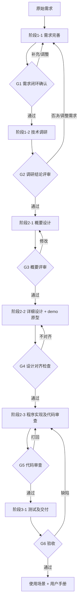

# 开发流程总览

适用：以本仓库规范开发的每个模块/程序，从原始需求受理到测试交付、用户手册的全流程。
定位：本文档是各调用方 skill 的总纲——每个阶段由对应 skill 驱动 AI 产出，人工在每个卡点（G1–G6）验证确认后方可进入下一阶段，AI 不得自行跨越卡点。
维护：流程调整先改本文档，再同步各阶段 skill 与模板。

## 1. 前置输入（任务开始前必须就位）

| 类别 | 文件 | 用途 | 就位要求 |
|------|------|------|---------|
| 通用规范 | standards/ 四份（命名规范、术语表、字段约束、日志规范） | 全程硬约束，调用方指令不得降低 | 已定稿，skill 加载即生效 |
| 产品资料 | product/产品资料-产品形态文档.md | 产品运行的基础环境、固定参数、组件清单 | 调研任务（1-2）开始前必须已填写 |
| 产品资料 | product/产品资料-产品web风格文档.md | Web 界面风格约定 | 涉及界面产出的阶段（2-2/3-1）开始前必须已填写 |
| 原始需求 | 需求提出方提供（领导/客户/现场归纳） | 阶段 1-1 的唯一输入 | 原文一字不改记入需求文档；允许泛化、无指标 |

> 注：原始笔记中引用《前置必备-产品形态文档.md》《前置必备-产品web风格文档.md》，与 product/ 实际文件名（产品资料-*）不一致。本文档统一按实际文件名引用，是否统一改名见 §7。

## 2. 流程总览



回退规则：任一阶段发现上游问题，回到对应上游阶段修正并重新过卡点，禁止在下游悄悄绕过。例：2-2 发现 2-1 子环节划分不合理 → 回 2-1；3-1 发现实现缺陷 → 回 2-3；1-2 实测否决需求 → 回 1-1 调整闭环状态。

## 3. 阶段定义

### 阶段 1-1 需求完善（skill：需求完善）

| 项 | 内容 |
|----|------|
| 产物 | `docs/阶段1-1-调研-<模块名>需求文档（需闭环）.md` |
| 角色 | 高级产品经理 + 高级开发 |
| 输入 | 原始需求、产品形态文档 |

要点：

- 泛化需求作为**独立章节**呈现，原文不可修改。原文可能是领导突发奇想的宽泛诉求（如「实现文件同步」，无协议/性能/功能要求），也可能是现场归纳的优化项（如「数据库同步要求实时」）；也可能只是稍带几条简单要求。
- 原文不可修改 ≠ 需求不能调整。例：领导提出「实现文件实时同步」，原文必须保留；若调研发现现有产品架构无法保证实时，可在最终需求中调整为「正常情况下延迟不超过 X 秒」，但必须说明原因、验证依据，并由**有权限的人员确认**，不能由 AI 擅自决定。
- 原始需求中的每项诉求都要登记闭环状态，不能只保留原文不记处理结果：
  - **已落实**：已转化为明确需求
  - **已调整**：说明调整原因和确认依据
  - **暂不实现**：说明原因及后续安排
  - **待确认**：尚未形成最终结论
- 形成此功能在产品中的运行形态：描述用户可输入项、性能需求。

出口（G1）：无未指派的「待确认」项；调整项均有原因、依据、确认人；人工确认闭环。

> 待确认：原始笔记写「根据上一阶段的技术调研」，但 1-1 是首阶段。本文按「输入 = 原始需求 + 产品形态文档」理解；若本意是先调研后需求（1-1/1-2 顺序互换），见 §7。

### 阶段 1-2 技术调研（skill：技术调研）

| 项 | 内容 |
|----|------|
| 产物 | `docs/阶段1-2-调研-<模块名>技术调研.md` |
| 角色 | 高级开发 |
| 输入 | 1-1 需求文档、产品形态文档 |

要点：

- 根据泛化需求搜索候选技术，结合产品已有基础形态、组件筛选。
- 按产品实际情况搭建环境实测，进行各种模态的调研：完整测试流程、测试结果全部保留；调研所用的硬件环境必须记录。
- **可以否决上一阶段的需求**（附实测依据），不得强行迎合需求。
- 使用 grill-me skill 对调研结论自查完善。

出口（G2）：候选技术均有实测数据；硬件环境已记录；对需求的否决/调整项已列明依据；人工评审通过。

### 阶段 2-1 概要设计（skill：设计文档）

| 项 | 内容 |
|----|------|
| 产物 | `docs/阶段2-1-开发-<模块名>概要设计（Mermaid 图、人读）.md` |
| 角色 | 架构设计 |
| 输入 | 1-1、1-2 产物 |

要点：功能工作形态以 Mermaid 图为主；描述包含的子环节及环节之间的关系；面向人类阅读；遵循概要设计模板。

出口（G3）：子环节划分与环节关系经人工评审。

### 阶段 2-2 详细设计 + demo 原型（skill：设计文档）

| 项 | 内容 |
|----|------|
| 产物 | `docs/阶段2-2-开发-<模块名>详细设计（AI 读）.md`；`prototype/<模块名>demo原型.html` |
| 角色 | C 语言开发专家、Linux 系统行家、Python 语言开发专家、Vue 语言开发专家 |
| 输入 | 1-2、2-1 产物、产品web风格文档（必须读取）；如有指定风格页面可提前提供 |

要点：函数、结构体级的详细设计；面向 AI 读取；需与 2-1 对齐；生成含假数据的 web demo 原型。

出口（G4）：人工抽查——2-2 与 2-1 无偏差；demo 原型与风格文档一致。

### 阶段 2-3 程序实现及代码审查（skill：程序实现及代码审查）

| 项 | 内容 |
|----|------|
| 产物 | 代码；`docs/阶段2-3-开发-<模块名>实现及代码审查.md` |
| 输入 | 2-2 详细设计；standards/ 四份规范 |

要点（**原始笔记仅列标题，以下为建议框架，待确认**）：

- 实现严格按 2-2 详细设计；公共字段命名、输入校验、日志输出全部满足四份通用规范。
- 代码审查以各规范的「完成前自检清单」为底稿逐条核对，审查记录（问题、修复情况、残留风险）写入 2-3 文档。
- 审查不通过处回退修复后复检，直至清单全过。

出口（G5）：四份规范自检清单全过；人工审查确认。

### 阶段 3-1 测试及交付（skill：程序测试及交付）

| 项 | 内容 |
|----|------|
| 产物 | `test/阶段3-1-测试-<模块名>测试及交付文档.md` |
| 输入 | 产品web风格文档（必须加载）、1-1 需求文档（闭环依据）、2-2/2-3 产物 |

要点：

- 描述测试环境。
- 测试 CLI。
- 测试功能以及系统配置项，逐层核对：如地址对象——对外提供的字符串、Linux 后台存储、垂直整合均需覆盖。
- Web 测试：增删改查、回显、多选等；界面风格需一致，横平竖直需一致。
- **与 1-1 需求文档逐项闭环**（原始笔记写「与 1-3 闭环」，编号系笔误，指 1-1）。

出口（G6）：需求逐项验收通过；交付物齐全；人工验收。

### 阶段 4 使用场景与用户手册（skill：使用场景及用户手册）

| 项 | 内容 |
|----|------|
| 产物 | `<模块名>使用场景.md`；`<模块名>用户手册.docx` |

面向最终使用者。原始笔记写 `.word`，本文统一为 `.docx`（生成方式待定，见 §7）。

## 4. 人工卡点总表

流程把控的核心：每个卡点都是人工验证 AI 产出的位置，未通过不得进入下一阶段。

| 卡点 | 时机 | 人工验证内容 | 确认人（建议值，待定） |
|------|------|-------------|----------------------|
| G1 | 1-1 后 | 闭环状态是否合理；调整项的原因与依据是否成立；「待确认」项是否指派到人 | 有权限的需求确认人 |
| G2 | 1-2 后 | 抽查实测过程与结果（环境、数据是否真实可信）；技术选型是否合理；需求否决是否成立 | 技术负责人 |
| G3 | 2-1 后 | 子环节划分、环节关系是否合理；图表达是否清楚 | 开发负责人 |
| G4 | 2-2 后 | 概要与详细设计是否对齐；demo 原型与风格文档是否一致 | 开发负责人 |
| G5 | 2-3 后 | 四份规范自检清单逐条核对；代码质量抽查 | 代码审查人 |
| G6 | 3-1 后 | 需求逐项验收；交付物齐全性 | 产品 + 测试负责人 |

## 5. 产物目录约定

每个模块/程序一个目录（`<模块名>` 替换为实际名称后，文件名中不得再含 `/`）：

```
<模块名>/
├── docs/
│   ├── 阶段1-1-调研-<模块名>需求文档（需闭环）.md
│   ├── 阶段1-2-调研-<模块名>技术调研.md
│   ├── 阶段2-1-开发-<模块名>概要设计（Mermaid 图、人读）.md
│   ├── 阶段2-2-开发-<模块名>详细设计（AI 读）.md
│   └── 阶段2-3-开发-<模块名>实现及代码审查.md
├── prototype/
│   └── <模块名>demo原型.html
└── test/
    └── 阶段3-1-测试-<模块名>测试及交付文档.md
```

## 6. 进度跟踪（每模块一张，随卡点更新）

| 阶段 | 状态（未开始/进行中/待卡点/通过） | 卡点确认人 | 确认日期 | 备注 |
|------|--------------------------------|-----------|---------|------|
| 1-1 需求完善 | | | | |
| 1-2 技术调研 | | | | |
| 2-1 概要设计 | | | | |
| 2-2 详细设计 | | | | |
| 2-3 实现及审查 | | | | |
| 3-1 测试及交付 | | | | |
| 使用场景/用户手册 | | | | |

## 7. 待补充事项（需人工决策）

- [ ] **2-3/3-1 文档模板未建**：1-1/1-2/2-1/2-2 四份模板已建于 templates/（按 callee 变体：章节骨架 + `> 填写：`说明行 + 完成前自检清单）；2-3、3-1 模板待建（2-3 建议先确认本文 §3 的建议框架再编模板）。
- [ ] **2-3 阶段细则**：原始笔记仅列标题，本文 §3 的建议框架需你确认或改写。
- [ ] **原始需求入口**：需求从何处登记（Git issue / 会议纪要 / 专用文档）？泛化需求的「原文」以什么为准？
- [ ] **卡点确认人**：G1–G6 的确认人目前是建议值，需落到具体人/岗位。
- [ ] **1-1 输入顺序**：原始笔记「根据上一阶段的技术调研」与 1-1 为首阶段矛盾（见 §3 待确认）。
- [ ] **编号笔误**：原始笔记 2-2「根据 1-2、1-3」、3-1「与 1-3 闭环」中的 1-3 不存在；本文按 1-1/1-2 理解，请确认。
- [ ] **grill-me skill**：1-2 引用了它，计划搜集后收录到 awesome-skills/（登记方式见其 README），再由 1-2 调用。
- [ ] **产品资料文件名**：原始笔记引用《前置必备-*》，实际文件为《产品资料-*》，二者取其一统一（改名或改引用）。
- [ ] **文档命名与命名规范的冲突**：naming-standard.md 规定文档类文件用 kebab-case，但仓库文档实际为中文文件名；需明确中文文档名是否豁免，或文档统一改英文名。
- [ ] **用户手册格式与生成方式**：.docx 由 AI 如何产出（pandoc 转换 / 模板填充）？是否需要配套截图？
- [ ] **需求变更回流**：开发中途新增/变更需求，是否回到 1-1 重新闭环？
- [ ] **测试自动化**：3-1 是否要求测试脚本/用例留存可复跑，还是仅文档记录？
