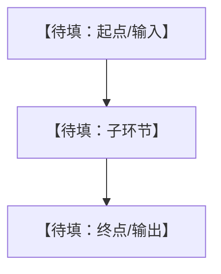
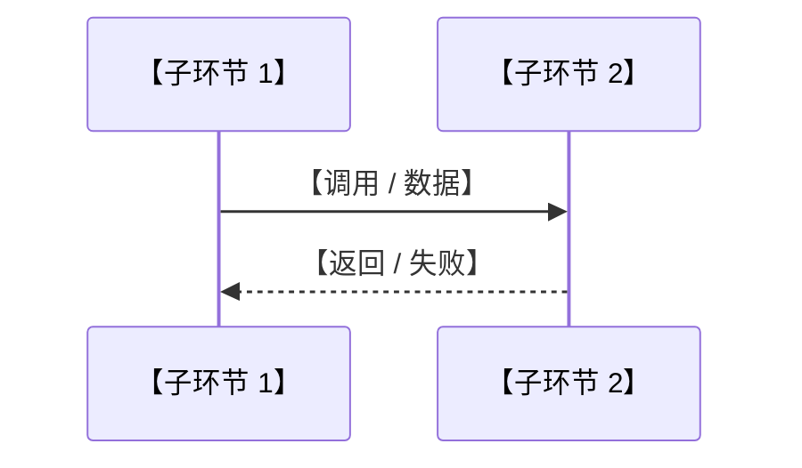

# 阶段2-1-开发-【模块名】概要设计（Mermaid 图、人读）

适用：模块/程序开发阶段 2-1 的产物文档，由 skill「设计文档」（角色：架构设计）依据 1-1、1-2 产物填写。
优先级：**面向人类评审**——Mermaid 图为主、文字为辅，文字只补图说不清的部分；子环节划分以本文档为准，2-2 不得偏离。
使用说明：本文件为模板。使用时复制到 `<模块名>/docs/` 并改名为 `阶段2-1-开发-<模块名>概要设计（Mermaid 图、人读）.md`，文件名与正文中的【模块名】替换为实际名称；`> 填写：`引注行说明该节应记录的内容，该节完成后删除对应引注行；`【待填：…】`为必须填充的槽位；`【示例：…】`仅供示范格式，可删。全部完成后删除本行。

## 文档信息

| 项 | 内容 |
|----|------|
| 模块名 | 【待填】 |
| 阶段 | 2-1 概要设计（卡点 G3） |
| 撰写角色 | 架构设计 |
| 输入 | 1-1 需求文档、1-2 技术调研 |
| 状态 | 【未开始 / 进行中 / 待卡点 G3 / G3 通过】 |

## 修订记录

| 日期 | 版本 | 修改内容 | 修改人 |
|------|------|---------|--------|
| 【示例：2026-10-23】 | v0.1 | 初稿 | 【待填】 |

## 1. 设计目标与范围

> 填写：3~5 句说清——本模块做什么、不做什么（引 1-1 §5.4 非目标）、采用什么技术路线（引 1-2 §5 选型结论）。不复制上游文档内容，只引结论与章节号，保持本文档可独立评审。

【待填】

## 2. 总体工作形态（总图）

> 填写：一张 mermaid 总图表达功能整体的数据流/控制流；图下配 3~5 句阅读说明（图例、主线路径、关键分支含义）。人读第一原则：评审人不翻上游文档也能看懂本图。



阅读说明：【待填】

## 3. 子环节划分

> 填写：功能拆分为哪些子环节，每个子环节职责一句话说清；输入/输出写到与 2-2 可对接的粒度。自查：子环节间职责不重叠、合并起来对需求无遗漏（对照 §8）。子环节命名先查 standards/naming-glossary.md，新概念先登记。

| 子环节 | 职责 | 输入 | 输出 | 承载诉求 |
|--------|------|------|------|---------|
| 【示例：变更捕获】 | 【监测源目录文件变化并产生事件】 | 【源目录路径】 | 【变更事件】 | R-01 |
| 【待填】 | 【待填】 | 【待填】 | 【待填】 | 【R-xx】 |

## 4. 环节间关系

> 填写：子环节之间的调用/数据/依赖关系，用 mermaid 表达（调用关系用 flowchart，时序与并发约束用 sequence）。同步还是异步、阻塞点在哪、一个环节失败后影响如何传播，要能从图和说明里直接读出。



关系说明：【待填：时序约束、异步边界、失败传播路径】

## 5. 关键流程（按典型场景）

> 填写：从 1-1 选取代表性场景各画一张时序图——至少一个正常流、一个异常/失败流。正常流验证设计可行，异常流验证失败处置有明确归属（哪个环节负责、如何恢复或上报）。

### 5.1 场景【名称】（正常流）

```mermaid
sequenceDiagram
    【待填】
```

### 5.2 场景【名称】（异常流）

```mermaid
sequenceDiagram
    【待填】
```

## 6. 与产品环境的对接

> 填写：本设计占用/引用的产品资源——网口、端口、系统路径、环境变量、已有组件。**只允许引用 product/产品资料-产品形态文档.md 已登记项**；需要新增占用的，先在该文档登记再回填本表（登记在先、使用在后）。

| 资源类型 | 登记名/取值 | 用途 | 产品形态文档出处 |
|---------|------------|------|-----------------|
| 【示例：TCP 端口】 | 【待填】 | 【服务监听】 | §4 端口分配 |
| 【待填】 | 【待填】 | 【待填】 | 【待填】 |

## 7. 与规范的设计联动（点位标注）

> 填写：概要级标注四份规范在本设计中的落点，只标位置不展开规则（细节由 2-2 展开）——哪些输入点将按 standards/field-constraint.md 校验；哪些操作按 standards/logging-standard.md 记管理操作日志（五要素）；新概念在 standards/naming-glossary.md 的登记情况。

| 规范 | 落点（子环节/位置） | 说明 |
|------|--------------------|------|
| field-constraint | 【待填：输入点清单】 | 校验规则在 2-2 展开 |
| logging-standard | 【待填：管理操作点位】 | 五要素在 2-2 展开 |
| naming-glossary | 【待填 / 无新增】 | 新概念登记情况 |

## 8. 与需求的对齐核对

> 填写：1-1 §2 的每项诉求（含「暂不实现」项）映射到承载子环节，或明确不落地及原因，保证无漏项。「待确认」项在 G3 前应已闭环（回 1-1 处理），未闭环的在此注明。

| 诉求编号 | 状态 | 承载子环节 / 不落地原因 |
|---------|------|------------------------|
| R-xx | 【已落实 / 暂不实现】 | 【待填】 |

## 9. 卡点确认（G3）

> 出口条件：子环节划分与环节关系经人工评审通过后，方可进入阶段 2-2。本节由人工填写，AI 不得代填。

| 确认人 | 确认日期 | 结论（通过 / 退回） | 退回原因 / 遗留问题 |
|--------|---------|--------------------|--------------------|
| 【人工填写】 | 【待填】 | 【待填】 | 【待填】 |

## 完成前自检

- [ ] Mermaid 图为主，每张图下有阅读说明，评审人不翻上游文档也能读懂
- [ ] §3 子环节职责无重叠、合并无遗漏，命名已查/已登记术语表
- [ ] §5 覆盖至少一个正常流与一个异常流，异常处置有归属
- [ ] §6 资源引用均为产品形态文档已登记项，无自造资源
- [ ] §7 规范落点已标注（只标位置，细节留 2-2）
- [ ] §8 每项诉求均有去向（承载子环节或明确不落地），「待确认」项已闭环或注明
- [ ] 未复制上游文档大段原文，只引结论与章节号
- [ ] 引注行（`> 填写：`）全部删除，【待填】槽位无残留
